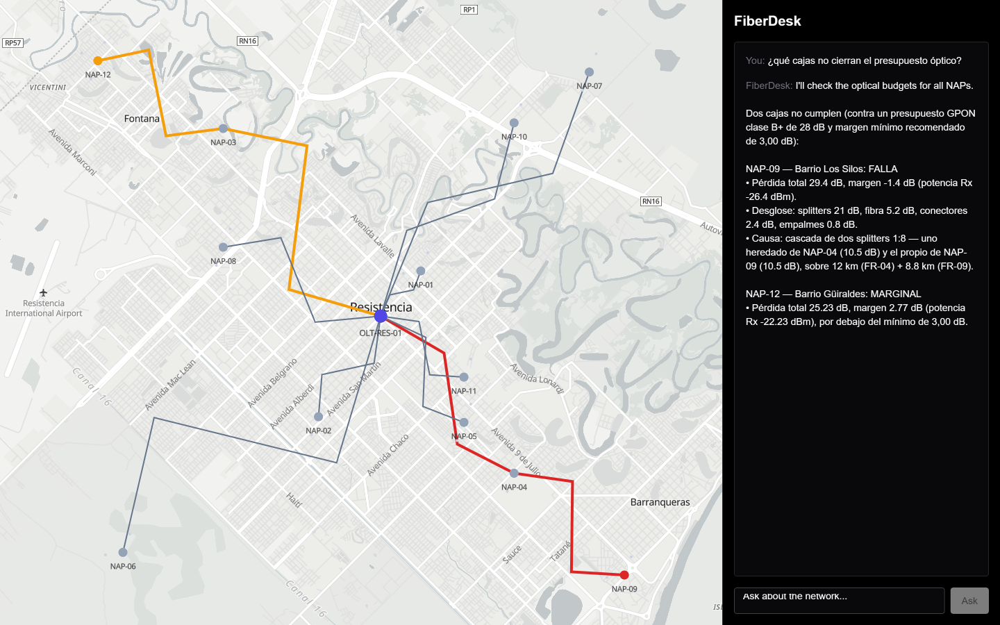

# FiberDesk

An AI copilot over an FTTH network: an interactive map plus technical documentation.



*Asked "which NAPs fail the optical budget?" — in Spanish, as the screenshot shows — the assistant
surveys all twelve NAPs, then details only the two that need it, while the map colours them by
classification — NAP-09 failing in red, NAP-12 marginal in amber — and traces each one's path back
to the OLT. Every figure in that answer came from the budget engine, not from the model. The answer
shown is the one from the recorded live run in
`openspec/changes/archive/2026-09-22-add-map-copilot/verification.md`.*

You see the fiber infrastructure drawn on a map — the OLT, the splitter enclosures (NAPs), the
fiber runs, the subscribers — and ask questions in plain language. The assistant answers *and*
highlights the answer on the map. It also computes the optical power budget of any link, and
answers from loaded technical documentation while citing its source.

**The rule that shapes every design decision:** the model reasons and orchestrates, the code
calculates. The LLM decides *what* to compute and over *which* entities, then explains the result.
The arithmetic is done by deterministic TypeScript that always returns the same answer. A numeric
answer produced by the model instead of a tool is a bug, not a shortcut.

## Status

**Phase 0 — foundations — done.** The scaffold, the spec workflow and the network dataset are in
place.

**Phase 1 — the conversational core — done.** The optical budget engine and the assistant that
calls it are both in place. Phase 1 is demonstrable end to end: ask a question, watch the answer
stream in.

**Phase 2 — documentation search — done.** The assistant can search a corpus of technical
documentation and cite what it finds, and can compare a documented figure against the system's
own optical constants. No vector database, no second service — see *The documentation corpus*,
below, for why.

**Phase 3 — the map copilot — done.** The plain chat page is now a full-screen map with the chat
as a side panel. Every NAP the assistant highlights is coloured and reframed on the map, and any
NAP can be clicked for its optical budget breakdown — see *The map*, below.

**Phase 4 — production — in progress.** A live eval suite measures the assistant (see *Evals*),
and prompt caching cuts what repeated calls cost. The assistant has the three map capabilities its
users asked for:
- it traces one subscriber's link end to end;
- it says what a fiber cut takes down;
- it says whether a new customer can be connected at a point clicked on the map.

See *Tracing one subscriber*, *What a cut takes down* and *Can a customer connect here?*, below.
There is no deploy yet.

## Getting started

```bash
npm install
cp .env.example .env.local   # then set ANTHROPIC_API_KEY
npm run dev
```

The app runs at [http://localhost:3000](http://localhost:3000): the map and the network draw
immediately, key or not. Without a key, the chat panel still loads and reports the missing
variable as soon as you ask a question — see *Failing loudly*, below.

```bash
npm test          # run the suite once
npm run test:watch
```

Every test runs against recorded fixtures and the real seed. **None of them call the Anthropic
API** — see *The assistant*, below.

## The network dataset

`seed/network.json` holds the network the whole product reasons about: one OLT in Resistencia
(Chaco, Argentina), 12 NAPs across the city, the fiber runs connecting them, and the subscribers
they serve.

**Everything in it is invented.** The coordinates are real places and the physics is real, but no
element comes from a real operator, a real customer or a production system, and none ever will.

### The edge cases are deliberate

A network where every link passes cannot demonstrate anything — the product's core question is
*which links fail their optical budget*, and that question needs an answer. So the dataset is built
to contain failures:

| NAP | Total loss | Margin (B+ budget, 28 dB) | Why |
|---|---|---|---|
| **NAP-09** | 29.40 dB | **−1.40 dB** — fails | Two 1:8 splitters cascaded: 21 dB of splitter loss alone |
| **NAP-12** | 25.23 dB | **2.77 dB** — marginal | A 1:2 feeding a 1:16, plus 19.8 km of fiber; below the 3 dB minimum |
| **NAP-06** | 24.56 dB | 3.44 dB — passes | No cascade, but a 1:32 at the end of a 20 km run: just above the threshold |

The remaining nine NAPs pass with comfortable margin. Splitter cascades are the most common reason
a real link ends up marginal, so two of the three cases are cascades.

### Expected outcomes are committed as an oracle

`seed/expected-budgets.json` records, per NAP, the accumulated inputs (kilometres, connectors,
splices, splitter chain) and the loss figures they produce. It was derived by hand **before** any
calculator existed, so the Phase 1 optical budget engine has something independent to be checked
against. If the two disagree, one of them is wrong, and the disagreement is the signal.

⚠️ The loss values behind those figures (0.25 dB/km, 0.40 dB per connector, 0.08 dB per splice, and
the splitter table) are industry-typical and **pending validation** against real specifications.
Do not treat them as established fact.

### Loading it

`src/lib/network/load.ts` reads and validates the seed on the server. Validation is all-or-nothing:
you get a network satisfying every structural rule — single root, no cascade cycles, every
reference resolving, supported splitter ratios, coordinates inside the modelled city — or an error
naming what broke. Nothing is silently dropped, defaulted or repaired.

## The optical budget engine

`src/lib/optical/` computes how much a link from the OLT to a NAP attenuates, how much headroom
that leaves against the OLT's declared GPON class, and what that headroom means.

**This arithmetic never runs in the model.** `calculateBudget(network, napId)` is plain,
deterministic TypeScript: same inputs, same output, every time. In the next change, the model's
job is to decide which NAPs to ask about and to explain the result in words — never to compute a
number itself.

```ts
const result = calculateBudget(network, "NAP-12");
// { total_loss_db: 25.23, margin_db: 2.77, status: "marginal",
//   rx_power_dbm: -22.23, by_source: { fiber_db: 4.95, splitters_db: 17, ... },
//   hops: [ { run_id: "FR-03", splitter: { at: "NAP-03", ratio: "1:2", ... } },
//           { run_id: "FR-12", splitter: { at: "NAP-12", ratio: "1:16", ... } } ] }
```

The result carries a per-hop breakdown, not just a total, because *explaining* a marginal link
means naming which cascade is responsible — NAP-12's 17 dB of splitter loss splits into 13.50 dB
of its own 1:16 and 3.50 dB inherited from NAP-03 upstream. Without that attribution, an
explanation can only be guessed at, which is exactly what this project is built to avoid.

`calculateAllBudgets(network)` evaluates every NAP in one pass. It is a plain `map` over the
single-NAP function — one implementation of the arithmetic, never two that could drift apart.

Every optical constant — fiber attenuation, connector and splice loss, splitter insertion loss,
the per-class GPON budget — lives in `src/lib/optical/constants.ts`, each commented with its unit
and its standing as industry-typical and **pending validation**. The 3 dB minimum margin used to
classify a link lives there too, but separately: it is an operational recommendation, not a
physical constant, and every call can override it.

**The dataset's fixture is bound to the tests.** `seed/expected-budgets.json` was derived by hand
before this engine existed; `src/lib/optical/fixture.test.ts` asserts the engine reproduces it
exactly, for all 12 NAPs. Editing a constant now fails the suite — on purpose, so that change has
to go through a spec rather than land as a quiet data edit.

### Tracing one subscriber

`traceSubscriber(network, subscriberId)` extends a NAP's budget to one customer's ONT. It takes
the serving NAP's budget exactly as `calculateBudget` reports it, so it never walks the tree a
second time, and adds the **drop**: the last stretch of fiber from the NAP to the customer.

```ts
const trace = traceSubscriber(network, "SUB-025");
// NAP-12's own budget: 25.23 dB, margin 2.77 dB, marginal
// drop: 0.383 km (383 m) in straight line × 1.3 slack = 0.498 km (498 m)
//       → 0.12 dB of fiber + 2 × 0.40 dB connectors = 0.92 dB
// { total_loss_db: 26.15, margin_db: 1.85, status: "marginal", rx_power_dbm: -23.15 }
```

**The drop is a model, not a measurement.** The seed has no drop cables, only the straight line
from each NAP to its subscribers. The drop's length is that distance, by haversine, times a slack
factor of **1.3**, and it adds **2 connectors** (the NAP port and the ONT). Each length is stated
in km and in metres, so an answer never has to convert one into the other. Both values sit in
`constants.ts` beside the others, as assumptions **pending validation**. They were chosen in the
handoff as industry-typical starting points, and no published source backs them yet. The received
power at the ONT is an estimate too, and no receiver sensitivity is modelled, so the system never
says whether an ONT "will work".

**A box that passes does not vouch for its customers.** NAP-06 passes with 3.44 dB of margin, but
the 0.92 dB drop leaves each of its three subscribers **marginal** at 2.52 dB. A subscriber is
classified on its own link, never on its NAP's.

Like the NAP engine, the trace is bound to an oracle: `seed/expected-traces.json`, all 28
subscribers, derived by `seed/derive-expected-traces.py` — a second implementation in another
language, written from the spec rather than from this code.

**Scale limit.** The trace tool lists all 28 subscriber ids in its schema. That works for a seed
this size; with thousands of subscribers it would need a search tool in front of it instead.

### What a cut takes down

`cutImpact(network, elementId)` in `src/lib/topology/` answers "if this breaks, who loses
service?" for one fiber run or one NAP. It walks the tree downstream, through cascades, and returns
every NAP, subscriber and fiber run left without service, with the counts. It computes no light,
only topology, so it lives apart from the optical engine.

```ts
const impact = cutImpact(network, "FR-03");
// naps_out_of_service:        NAP-03, NAP-12 (through the cascade)
// subscribers_out_of_service: SUB-006, SUB-025, SUB-026, SUB-027, SUB-028
// runs_out_of_service:        FR-12
// counts: { naps: 2, subscribers: 5, runs: 1 }
```

NAP-03 serves one subscriber of its own, but cutting the run that feeds it takes out five, because
NAP-12 hangs below it. **The counts are part of the result** so the model can cite them: a model
that counts a list itself is doing arithmetic, which this project does not allow.

Losing a NAP and cutting its feeder run take out the same elements. They differ only in which one
is reported as cut. A cut at the OLT is refused as not supported, and so is an element the network
does not have. A cut here is total and hypothetical: no partial damage, no rerouting (the network
is a tree) and no repair times. The 24 possible cuts are checked against a hand-derived oracle,
`seed/expected-cut-impacts.json`.

### Can a customer connect here?

`evaluateConnection(network, point)` in `src/lib/feasibility/` answers the question sales and field
planning ask most: can a new customer be connected at this point on the map? It always evaluates
**the three NAPs nearest to the point**, and runs three checks on each:

- **Drop distance.** The drop route, modelled exactly as in a subscriber's trace, must be at most
  **600 m**.
- **Free ports.** Free ports are the splitter's outputs, less the subscribers it serves, less the
  child NAPs it feeds. Feeding a cascade uses up a port, which is why NAP-03 (a 1:2 serving one
  subscriber and feeding NAP-12) is full.
- **Projected budget.** The NAP's own budget plus the new drop must not fail.

A NAP that fails a check is still returned, with every reason that applies (`too_far`,
`no_free_ports`, `budget_fail`). Feasible candidates come first, and the result names the best one
and how many are feasible.

```ts
const result = evaluateConnection(network, { lat: -27.4659, lon: -58.97 });
// #1 NAP-11 (1:16): 434 m straight, 564 m of route, 14 free ports, drop 0.94 dB
//    → projected 16.61 dB, margin 11.39 dB, pass — feasible
// #2 NAP-05 (1:8):  456 m straight, 593 m of route, 6 free ports, drop 0.95 dB
//    → projected 14.17 dB, margin 13.83 dB, pass — feasible
// #3 NAP-04 (1:8):  1759 m straight, 2287 m of route — not feasible: too_far
// best_nap_id: "NAP-11", feasible_count: 2
```

The seed already holds the cases worth showing:
- next to NAP-03, the nearest box is full;
- next to NAP-09, the box has five free ports, but no new link there closes its budget (margin
  −2.25 dB);
- 414 m from NAP-06, the connection is feasible but marginal (2.51 dB), although NAP-06 itself
  passes.

**The 600 m maximum is an assumption, pending validation.** The handoff suggested about 300 m. But
every seed subscriber sits 346–383 m in straight line from its NAP, so 450–498 m of modelled drop,
and under 300 m no existing customer could have been connected to its own box. The owner chose to
move the maximum, measured on the route rather than the straight line, and to leave the seed and
the slack factor alone. It lives in `constants.ts` as an operational limit, beside the minimum
margin.

The engine is bound to `seed/expected-feasibility.json`: six points and all 28 subscriber
positions, derived by `seed/derive-expected-feasibility.py`, an independent implementation in
Python. Planting a new customer exactly where an existing one is projects the same figures as that
subscriber's trace.

## The assistant

`src/lib/assistant/` and `src/app/api/chat/route.ts` are the copilot: a route handler that streams
an answer while orchestrating the optical budget engine and the documentation corpus through tool
calls. **The model never computes a number and never states a documented figure it did not just
retrieve.** Every figure it states comes from one of seven tools, named for the shape of their
answer rather than the operation:

- **`summarize_optical_budgets`** — one thin row per NAP (id, name, total loss, margin, status).
  No required arguments, so the model does not need to know any NAP identifier in advance. Call
  this first.
- **`detail_optical_budget`** — the full per-hop breakdown for one NAP, the only source that can
  attribute a loss to a specific fiber run or splitter. Call this after, only for the NAPs worth
  explaining.
- **`trace_subscriber_link`** — one subscriber's link traced end to end, from the OLT through its
  NAP and the drop to its ONT, with the subscriber's own status beside its NAP's. Its argument is
  one of the 28 subscriber ids, so an id the network lacks cannot be traced.
- **`list_cut_impact`** — what a cut of one fiber run or NAP takes out of service downstream, with
  the counts. Its argument is one of the 12 runs or 12 NAPs; the OLT is not on the list.
- **`list_connection_candidates`** — the three NAPs nearest to the point selected on the map, each
  with its verdict and reasons. It takes **no arguments**: see *The map context*, below.
- **`search_documentation`** — the passages in the technical corpus that match a query, returned
  as citable `search_result` blocks. See *The documentation corpus*, below.
- **`get_optical_constants`** — what the system itself computes with, so a documented figure can
  be checked against it rather than assumed to agree.

Survey first, detail second: twelve full breakdowns cost roughly 1,650 tokens against roughly 630
for a survey plus detail on the two links that actually fail — and firing all twelve at once would
require the model to already know every identifier, which the survey exists to avoid.

**The map highlight is projected in code, never emitted by the model.** Each entry names its kind:
- a NAP, a subscriber or a fiber run, with its status: a budget classification, or `cut` /
  `out_of_service` for an outage, which outranks it;
- or, for a feasibility answer, the evaluated `point` and one `candidate` per NAP, with its rank
  and its feasibility. Every field in it — identifier, status, margin —
already exists in a tool result. Asking the model to repeat it back
would be asking it to copy numbers, and copying is exactly where a model writes 2.7 for 2.77.

There is no server-side conversation store. Each streamed turn ends with the exact updated message
array the server sent to the model — tool calls and results intact — and the browser tab holds
that array and resends it verbatim on the next question. Close the tab and the conversation is
gone; that is by design for now.

### The map context

The chat request carries the map's state beside the conversation: `map_context.selected_point`,
the point the user clicked. The route rejects a point outside the modelled city before any model
call. The point then goes only to the tool that reads it, never into the system prompt or the
messages. Two things follow:

- **The model never copies a coordinate.** It would be the same mistake the projected highlight
  avoids. The tool echoes the point it evaluated, so any coordinate in an answer is grounded.
- **The cached prompt prefix is the same for every click,** and the history the browser resends
  carries no stale "a point is selected" marker.

With no point selected, the tool returns an error that tells the model to ask for a click.
Coordinates typed into the chat get the same answer: the assistant asks the user to select the
point on the map instead of evaluating a location it cannot pass to the tool.

### Failing loudly

Ask a question without `ANTHROPIC_API_KEY` set and the chat page shows the error in place, rather
than hanging or crashing — the same "fail with a named error, never a silent gap" principle the
network loader follows.

### Tests never call the API

Every test in `src/lib/assistant/` runs against recorded fixtures — literal `Message` objects
standing in for what the API would return — with the tools executing for real against the seed.
The loop, the dispatcher, the highlight projection and the SSE encoding are all exercised this way;
the model itself is not. Some behaviours can't be tested this way at all — that the assistant
surveys before it drills into detail, that it says "I don't know" instead of inventing an answer,
that it cites what it retrieves, and that it surfaces rather than silently resolves a disagreement
between a document and the constants. Those are measured by the live eval suite instead.

### Evals

`npm run eval` asks the real model 42 cases (47 questions, counting follow-ups) and checks every
answer with deterministic graders — which tools it called and in what order, which NAPs,
subscribers, cut runs and candidate NAPs the map highlighted, whether every figure in the prose came from a tool, whether it
declined what the system does not model. It calls the API under a mandatory spend cap and is never
part of `npm test`. How it works, and what each grader does *not* check:
[`evals/README.md`](evals/README.md).

**Latest run** — `claude-opus-5`, effort `low`, prompt caching on, from
[`evals/runs/2026-10-12T19-04-33Z.regraded.json`](evals/runs/2026-10-12T19-04-33Z.regraded.json):

| Area | Passed | Rate | 95% Wilson interval |
|---|---|---|---|
| Can a customer connect here | 8/8 | 100.0% | 67.6%–100.0% |
| What a cut takes down | 6/6 | 100.0% | 61.0%–100.0% |
| Tracing one subscriber | 7/7 | 100.0% | 64.6%–100.0% |
| Declining what the system cannot answer | 5/5 | 100.0% | 56.6%–100.0% |
| Documentation | 5/5 | 100.0% | 56.6%–100.0% |
| Optical budget questions | 4/8 | 50.0% | 21.5%–78.5% |
| Multi-turn follow-ups | 2/3 | 66.7% | 20.8%–93.9% |
| **Overall** | **37/42** | **88.1%** | **75.0%–94.8%** |

Per question, the median cost is **$0.0176** as measured (**$0.0482** cold, with nothing in the
prompt cache), and p95 latency is **10.7 s**. The run cost $0.92.

The feasibility cases include:
- the full nearest NAP (NAP-03) and the failing one (NAP-09);
- a comfortable connection, and a feasible but marginal one (NAP-06);
- two feasible NAPs, and the follow-up "¿y si lo conecto a la segunda opción?";
- a point out of coverage, and no point selected.

The cut cases include a feeder cut through a cascade, a NAP down, a cut at the OLT, an element the
network lacks, and the follow-up "¿cuántos clientes son?". The trace cases include a subscriber
whose NAP passes while it does not, a lookup by name, an id the network lacks, and a question on
whether an ONT will work.

Every failure in this run is on the older cases. Twice the model answers from the survey without
fetching the breakdown. Four times it writes a figure no tool returned:
- "casi 20 km", twice (11.2 + 8.6 km);
- "las 12 NAPs", a count of the survey's rows;
- "superan los 10 dB", a threshold of its own.
Between two runs of nearly the same configuration, those older cases move by about three, so a
single run is a rough measure.

The first full run with feasibility caught one regression worth fixing. A trace answer converted
0.383 km into "383 m", a figure no tool returned. The drop now states both units. The readings
are in the `verification.md` of each change:
[`add-subscriber-trace`](openspec/changes/archive/2026-10-12-add-subscriber-trace/verification.md),
[`add-cut-impact`](openspec/changes/archive/2026-10-12-add-cut-impact/verification.md) and
[`add-feasibility`](openspec/changes/archive/2026-10-12-add-feasibility/verification.md).

**Can a cheaper model do this?** Not yet. The change `reduce-cost-per-question` tried to halve the
cost per question. Every configuration was judged by a rule fixed before any of them ran
(`npm run eval:decide`; the rule and every reading are in
[`evals/decision-log.md`](evals/decision-log.md)):

| Configuration | Run | Passed (95% interval) | Cost / question, cold: median · p95 | Measured: median · p95 | p95 latency | McNemar vs B1 | Verdict |
|---|---|---|---|---|---|---|---|
| `claude-opus-5`, `low`, no caching | B1, [record](evals/runs/2026-10-08T03-32-06Z.regraded.json) | 16/21, 76.2% (54.9–89.4%) | $0.0376 · $0.0663 | $0.0376 · $0.0663 | 13.1 s | — | baseline |
| `claude-opus-5`, `low`, no caching | B2, [record](evals/runs/2026-10-12T11-08-31Z.regraded.json) | 17/21, 81.0% (60.0–92.3%) | $0.0361 · $0.0653 | $0.0361 · $0.0653 | 15.6 s | 0 → / 1 ←, p = 1.00 | second baseline run |
| `claude-sonnet-5-5`, `low`, caching | [record](evals/runs/2026-10-12T11-33-18Z.json) | 17/21, 81.0% (60.0–92.3%) | $0.0103 · $0.0172 | $0.0046 · $0.0117 | 6.3 s | 1 → / 2 ←, p = 1.00 | **reject**: grounding veto on 2 stable cases |
| `claude-sonnet-5-5`, `medium`, caching | [record](evals/runs/2026-10-12T11-36-14Z.json) | 15/21, 71.4% (50.0–86.2%) | $0.0121 · $0.0184 | $0.0064 · $0.0127 | 7.3 s | 2 → / 1 ←, p = 1.00 | **reject**: grounding veto on 3 stable cases |
| `claude-opus-5-5`, caching | not run | — | projected 71% of B1 | — | — | — | not run: its projected cold cost cannot meet the 50% target |

How to read the table:

- **"Cold" is the cost of a question that arrives alone**, with nothing in the prompt cache. The
  eval runs its cases back to back, so the cache stays warm. The measured column shows that warm
  figure. A real demo question usually arrives alone, so the target is the cold median: at most
  50% of B1, $0.0188.
- **McNemar** counts the cases that went pass → fail and fail → pass against B1. It is reported
  for context and decides nothing. With so few disagreeing cases, nothing could be significant.
- **The Opus 5.5 projection** re-prices B1's own token counts at Opus 5.5 rates with caching.
  Reaching 50% would take about 30% fewer tokens per question, and it thinks more per effort
  level, not less.

**Both Sonnet configurations meet the cost target with room to spare, and both fail on the
project's hardest rule.** In several answers the model wrote a number no tool returned: "the other
9 NAPs" (12 − 3), "de las 12 cajas" (a count of the survey's rows), "disagree by 0.03 dB/km"
(0.25 − 0.22). Opus 5 does this kind of arithmetic too, but less often. On these cases it wrote no
count at all, or a 12 that passed only because the same number appears in a detail result it had
fetched. One more regression has no grader: at effort `low`, Sonnet answered an English question in
Spanish.

So the assistant stays on `claude-opus-5` at effort `low`. What did ship is **prompt caching**. It
changes no byte the model reads, so it needs no quality gate. Across the two Sonnet runs, 84 of 85
model calls read the ~2,400-token prefix from the cache. The next lever is the prompt, not the model:
stop the arithmetic in prose, then judge the cheaper configurations again under the same rule.

What fails on the baseline, read by hand in [`evals/grader-validation.md`](evals/grader-validation.md):

- **The model does arithmetic in prose.** Three answers state a figure no tool returned — "casi 20
  km", "~19.8 km" (11.2 + 8.6), "0.23 dB" (3.00 − 2.77). Correct sums, but the rule here is that
  the model computes nothing, and the grounding grader holds it to that.
- **It sometimes stops at the survey.** Asked "which NAPs fail the optical budget?" in English, it
  answered from the survey and *offered* the breakdown instead of fetching it, so the map
  highlighted nothing. Asked for the power reaching NAP-09, it said the system does not model
  received power, which is wrong: `detail_optical_budget` returns −26.4 dBm.
- Declining and documentation questions passed every case.

Read these numbers for what they are:

- **Two runs of the same configuration disagree on one case in 21.** B1 and B2 differ only on
  `conv-and-nap12-es`, through the grounding grader. That is the noise floor every comparison
  above is judged against. A grader that already flips between B1 and B2 cannot veto a
  candidate.
- **21 cases cannot show that a cheaper model is "no worse".** One case is 4.8 points, and the
  overall interval spans about 35. The veto and the hand reading of every case that changed carry
  the weight a significance test cannot.
- **The grounding grader checks membership, not attribution** — a real number attached to the
  wrong NAP passes — and counts written as words ("nueve restantes") are not checked. It was
  validated by hand on all 21 baseline answers before being trusted: after one fix, zero false
  positives and zero false negatives.
- **One case was corrected after the first run.** `budget-limit-es` required a map highlight that
  its question does not need, against the eval's own design. Removing that expectation moved it
  from fail to pass (15/21 → 16/21). Recorded, with the reasoning, in
  [`evals/grader-validation.md`](evals/grader-validation.md).

## The map

`src/components/NetworkMap.tsx` draws the whole synthetic network — the OLT, all 12 NAPs, every
fiber run along its stored geometry, and all 28 subscribers — on a [MapLibre
GL](https://maplibre.org/) map, the moment the page opens. Base tiles come from
[OpenFreeMap](https://openfreemap.org/), which needs no API key and no account: `src/lib/map/config.ts`
points at its hosted `positron` style. If that style can't be reached, the map falls back to a
plain background and keeps the network overlay interactive — the overlay is the product, the tiles
are decoration.

MapLibre 6 loads its web worker from a URL relative to its own bundle, and Turbopack does not emit
that file. `npm run dev` and `npm run build` therefore run `scripts/copy-maplibre-worker.mjs`
first, which copies the worker from `node_modules` into `public/maplibre/` (git-ignored), and the
map points MapLibre at it with `setWorkerUrl`.

**Every figure the map shows still comes from the server, unchanged.** `src/app/page.tsx` is a
server component: it loads the network and computes every NAP's budget once, with the same
`calculateBudget` engine described above, and hands both down as props. When a turn ends, the
assistant's `HighlightPayload` names every NAP, subscriber and fiber run to paint, each with its
status. `src/lib/map/highlight.ts` (`resolveHighlight`) resolves it against the loaded network. It
is a pure, unit-tested function that decides which NAPs and subscribers to colour, which runs to
mark (an element named twice takes the more severe status), and where to fit the view. It derives
no path or downstream set of its own: the payload lists the runs. A cut is drawn apart from the
budget colours: the cut element in magenta, everything out of service in a dark slate. The map
component only calls MapLibre's `setFeatureState` with that result; it never recolours,
reclassifies or recomputes anything itself.

**A feasibility answer** rings each candidate NAP by its verdict: teal if feasible, yellow if
feasible but marginal, dark grey if not. Each ring carries its rank, and a dashed blue drop line
runs from the evaluated point to the best candidate. The ring leaves the NAP's fill to its own
classification: a full NAP is not a failing one.

**Clicking empty map space** selects a point: a blue marker appears, and every chat request carries
it until it is cleared or moved. Selecting a new point clears a feasibility highlight that belonged
to the old one, and leaves any other highlight alone.

**Clicking any NAP** — highlighted or not, before or after asking a question — opens its full
optical budget breakdown: `src/lib/map/breakdown.ts` (`formatBreakdown`) formats a `BudgetResult`
into display rows, each numeric string exactly `value.toFixed(2)` of the figure the engine
produced. The panel displays; it does not add, subtract or round.

On a desktop-width screen the map fills the viewport with the chat as a ~400px right-hand column;
on a narrow screen they stack, map above chat, with no horizontal scrolling.

## The documentation corpus

`corpus/*.md` holds the technical documentation the assistant can search and cite. Each file is
plain Markdown: one `#` title, one or more `##` sections, each with at least one paragraph.

**Everything in it is invented**, the same as the network dataset — these read like GPON
deployment and specification notes, but no document is copied from a real vendor, a real operator,
or a published standard. A citation the assistant produces points at one of these invented
documents; the mechanism is real, the source is not.

### Why there is no vector database

The original plan for this phase was FastAPI, PostgreSQL and pgvector. It didn't survive three
facts, checked against the installed SDK rather than recalled: Anthropic has no embeddings
endpoint, so a vector database would mean a second AI provider for five documents; citations are
native (`citations: { enabled: true }`); and the `search_result` content block exists,
purpose-built for a tool to return citable passages.

What replaced it is `src/lib/corpus/`: a loader, a BM25 ranker, and a mapping from a ranked section
to a citable result — all TypeScript, all in-process, all covered by unit tests because the
ranking is deterministic. The model still closes the semantic gap BM25 can't: it composes the
search query, so a question in Spanish about "atenuación por humedad" becomes an English query
about moisture and water absorption before it ever reaches the ranker.

### The gap and the contradiction are deliberate

Same reasoning as the network dataset's edge cases: a corpus where everything is present and
everything agrees can't demonstrate anything.

- **A gap.** No document states an ONT receiver sensitivity figure — deliberately, because the
  optical constants don't model it either. Ask about it and the assistant should say so, the same
  answer it already gives when asked about the constant directly.
- **A contradiction.** `gpon-link-budget.md` states fiber attenuation at 1490 nm as 0.22 dB/km;
  `src/lib/optical/constants.ts` computes with 0.25. Ask what figure to use and the assistant
  should report both, name where each came from, and say they disagree — not pick one quietly.

### The scale this is built for

A handful of short documents, indexed in memory at process start with no persistence. This is a
deliberate choice, not a placeholder for something bigger: see `design.md` for when embeddings
would actually earn their cost. Replacing `corpus/` with your own Markdown files works as long as
you stay roughly in this range — the loader will happily index more, but relevance and cost both
degrade well before a corpus of hundreds of documents, and that scale needs a different design.

## How changes are made here

Every non-trivial change starts as an OpenSpec proposal, before any code is written. `openspec/`
holds that process: `specs/` is what the system does today, `changes/` is what is being proposed.

```bash
npx openspec list   # active changes
npx openspec view   # interactive dashboard
```

## Stack

Next.js (App Router) · TypeScript · Tailwind CSS · Vitest · the Anthropic SDK · MapLibre GL. No
database, no second service, no second language — documentation search is BM25 in the same
process as everything else, and the map's base tiles are the one thing that comes from outside
the app, from OpenFreeMap, with no key required.
